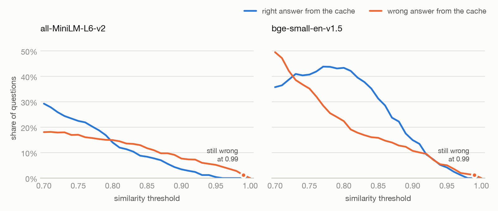

# semcache

**Cache model answers by meaning, not exact wording. And see exactly where that goes wrong.**

[](https://github.com/mohsinaliwork686-rgb/semcache/actions/workflows/ci.yml)
[](https://www.python.org/downloads/)
[](LICENSE)

<picture>
  <source media="(prefers-color-scheme: dark)" srcset="docs/images/tradeoff-dark.png">
  
</picture>

Every semantic cache shows how much it saves. This one also shows how often it gives the wrong
answer. The chart is 250 labelled support questions, replayed through the cache at every threshold
on two embedding models. The numbers are in [What the benchmark found](#what-the-benchmark-found).

---

## The problem

People ask a language model the same things all day, and every call costs time and money. A normal
cache does not help, because it matches the exact text, and nobody types a question the same way
twice. A semantic cache matches by meaning instead: if a new question is close enough to one it has
already answered, it returns that answer.

"Close enough" is the catch. These two questions are almost the same sentence:

```
Do I get free shipping on orders over $35?
Do I get free shipping on orders under $35?
```

They need opposite answers, and an embedding model scores them **0.995** out of 1. Set the threshold
too low and the second person gets the first person's answer: wrong, instantly, and with no warning.

## Try it

```bash
pip install "semcache[local] @ git+https://github.com/mohsinaliwork686-rgb/semcache"
```

One decorator wraps an existing function. The first run downloads a small embedding model (about
90 MB) that runs on your machine, with no API key.

```python
from semcache import semcache


@semcache(threshold=0.8, ttl=3600)
def ask(question: str, model: str = "small") -> str:
    print(f"  (calling the {model} model)")
    return f"answer to: {question}"


print(ask("How do I reset my password?"))
print(ask("how do i reset my password"))
print(ask("How do I reset my password?", model="large"))
print(ask("Do I get free shipping on orders over $35?"))
print(ask("Do I get free shipping on orders under $35?"))
```

```
  (calling the small model)
answer to: How do I reset my password?
answer to: How do I reset my password?
  (calling the large model)
answer to: How do I reset my password?
  (calling the small model)
answer to: Do I get free shipping on orders over $35?
answer to: Do I get free shipping on orders over $35?
```

The second question never reached the model. The third did, because it asked a different model.
The last one is the trap: it got the answer to a different question.

## What the benchmark found

The questions are for a made-up shop's support desk: 50 intents, 250 questions, and 15 pairs of
intents written to be nearly identical but need different answers. Each intent keeps its answer next
to its questions in [bench/questions.json](bench/questions.json).

Share of all questions answered from the cache, averaged over 5 shuffled orders. The rest went to
the model.

| Threshold | MiniLM: right | MiniLM: wrong | bge-small: right | bge-small: wrong |
|-----------|--------------:|--------------:|-----------------:|-----------------:|
| 0.70 | 29.3% | 18.1% | 35.8% | 49.5% |
| 0.75 | 22.5% | 17.0% | 40.7% | 35.2% |
| 0.80 | 14.0% | 15.0% | 43.4% | 22.4% |
| 0.85 | 8.4% | 11.8% | 31.3% | 15.8% |
| 0.90 | 3.4% | 7.7% | 15.0% | 10.7% |
| 0.95 | 0.4% | 5.2% | 4.2% | 5.0% |
| 0.99 | 0.0% | 1.2% | 0.0% | 1.2% |
| 1.00 | 0.0% | 0.0% | 0.0% | 0.0% |

- **A near-miss can score higher than a real paraphrase.** "Over $35" against "under $35" scores
  0.995 on MiniLM. "Which cards do you take?" against "can i pay with paypal", which share an
  answer, scores 0.11. No threshold can put those two pairs on the right sides.
- **Raising the threshold does not make it safe.** On MiniLM, wrong answers outnumber right ones at
  every threshold from 0.80 to 0.99, and from 0.96 to 0.99 every answer from the cache is wrong:
  only the near-identical pairs score that high. On this set, the only threshold with no wrong
  answers is 1.0, which is a normal exact-text cache.
- **A threshold only means something for its model.** At 0.80, bge-small answers 66% of questions
  from the cache and MiniLM answers 29%.
- **Lowering it does not always find more right answers.** bge-small peaks at 43.8% right at 0.77,
  then falls: a wrong hit means the right answer is never stored for later questions to find.

The average hides where it fails, so here is the share of each kind of question that got another
intent's answer, at 0.85:

| Kind of near-miss | Example | MiniLM | bge-small |
|-------------------|---------|-------:|----------:|
| Amount | orders over $35 / under $35 | 40.7% | 40.0% |
| Negation | an item I have used / haven't used | 29.3% | 30.0% |
| Timing | cancel before it ships / after it ships | 26.0% | 33.3% |
| Swapped thing | the iPhone app / the Android app | 2.0% | 25.3% |
| Same verb | change my password / change my email | 0.0% | 2.0% |
| None | every other question | 0.0% | 0.4% |

Embeddings are good at topic and poor at small words that flip the meaning. Questions that differ by
*what they are about* are safe. Questions that differ by a number or a "not" are not.

**What it saves.** With a simulated model call of 1 second and $0.001, bge-small at 0.85 skips 47% of
the calls: 108 seconds and 12 cents per 250 questions, after paying for every embedding. A third of
those skipped calls gave a wrong answer, which is why the saving is not the number to pick a
threshold by. Embedding one question took 5.7 ms on MiniLM and 37 ms on bge-small, on an Intel Mac.

## How to choose a threshold

There is deliberately no default. The right value depends on the embedding model and on how close
together your questions are, and a default would pick a point on that curve without telling you.

1. **Keep what flips the answer out of the text.** Every argument except the question must match
   exactly, so an argument is the strongest protection there is. `ask(question, tier="over_35")` and
   `ask(question, tier="under_35")` are never compared at all.
2. **Measure on your own questions.** Write them in the same format as
   [bench/questions.json](bench/questions.json), include the near-misses you are afraid of, and run
   the benchmark from a clone of this repository. Do this again whenever you change the embedding
   model.

   ```bash
   pip install -e ".[local]"
   python -m bench.run --questions my-questions.json --out my-results
   ```

3. **If a wrong answer is expensive, use `threshold=1.0`.** That is an exact-text cache, and you
   still get expiry, the size limit and Redis.
4. **Watch it in production.** `ask.cache.stats()` gives hits, misses, evictions and errors. Keep the
   `ttl` short enough that a bad answer doesn't live long.

## What it does

- **Exact text first.** A repeat is a hit with no embedding, so it is as fast as a normal cache.
- **Never mixes requests.** The first argument is matched by meaning (or name another with `on=`),
  and every other argument must match exactly. The same question to a different model, or with a
  different system prompt, never gets the other one's answer. Neither do two functions sharing one
  cache.
- **Expiry and a size limit.** `ttl` counts from when an answer was stored, and a hit does not extend
  it. When full, expired answers go first, then the least recently used.
- **In memory or in Redis.** Both stores pass the same test suite, and their scores match to within
  0.000001.
- **Sync and async.** In an `async def` function, the cache's work runs in a thread, so it never
  stalls the event loop.
- **Never breaks the call.** If the model won't load or Redis is down, your function runs as if the
  cache were not there, and the error is counted and logged.

### Sharing a cache through Redis

```bash
pip install "semcache[local,redis] @ git+https://github.com/mohsinaliwork686-rgb/semcache"
```

```python
from semcache import RedisStore, SemanticCache

cache = SemanticCache(
    threshold=0.95,
    ttl=3600,
    max_entries=10_000,
    store=RedisStore.from_url("redis://localhost:6379/0", name="support"),
)


@cache.cached(on="question")
async def ask(question: str, model: str = "small") -> str: ...
```

This needs Redis 8 or later: the search runs inside Redis, on its vector sets. Answers are stored as
JSON and never pickled, because unpickling data from a shared Redis would let anyone who can write
to it run code. An answer that isn't JSON-serialisable is simply not cached, and the error is counted.

### Without the decorator, or with your own embedder

`cache.lookup(question)` and `cache.store(question, answer)` work anywhere a decorator doesn't, such
as in front of a router like [llm-router](https://github.com/mohsinaliwork686-rgb/llm-router). An
embedder is anything that turns a list of strings into vectors, so `sentence-transformers` is one line:

```python
from sentence_transformers import SentenceTransformer

cache = SemanticCache(threshold=0.9, embedder=SentenceTransformer("all-MiniLM-L6-v2").encode)
```

## How far to trust the benchmark

- **The set is built to be hard.** 30 of the 50 intents are near-miss pairs, far more than real
  traffic has. Read it as *where* a semantic cache breaks, not how often it will on your questions.
- **I wrote and labelled it myself.** It is one made-up shop, in English. To keep that honest, it was
  [committed before any embedding code](docs/IMPLEMENTATION_PLAN.md#5a-what-counts-as-a-false-hit-and-how-the-benchmark-stays-honest)
  existed, labels were decided by reading, and any change after the first run must be logged in
  [bench/CHANGES.md](bench/CHANGES.md). It is still empty.
- **Each question is asked once,** so there are no exact repeats. Real traffic has them, and they are
  free right answers that this benchmark doesn't count.
- **An intent groups questions that share an answer,** not only paraphrases. Some "missed chances"
  are different questions that no cache should match.
- **The model is simulated.** Time and money saved scale with the figures above. Embedding time is
  real, and is subtracted.

To reproduce it, run `python -m bench.run` and then `python -m bench.chart`. A full run takes under a
minute, and the raw results are in [bench/results](bench/results). CI runs a short version on the
real model on every push, and its counts match a run on a Mac.

## Non-goals

- **Not a vector database.** A cache holds thousands of entries, not billions.
- **No streamed responses.** It caches whole answers.
- **No distributed invalidation.** Entries leave by age or by being least recently used.
- **No request coalescing.** If two identical questions miss at the same moment, both call the model.

## Development

```bash
python -m venv .venv && source .venv/bin/activate
pip install -e ".[local,redis,bench,dev]"
pytest                                                # the Redis tests skip without Redis
docker run -d -p 6379:6379 redis:8
REDIS_URL=redis://localhost:6379/0 pytest             # all 110 tests
```

The design and the reasons behind it are in [docs/IMPLEMENTATION_PLAN.md](docs/IMPLEMENTATION_PLAN.md).
CI runs on Python 3.11 to 3.14 with a real Redis 8, on macOS and Windows, and with the real model.

The name `semcache` is taken on PyPI, so it installs from this repository.

## License

MIT. See [LICENSE](LICENSE).
